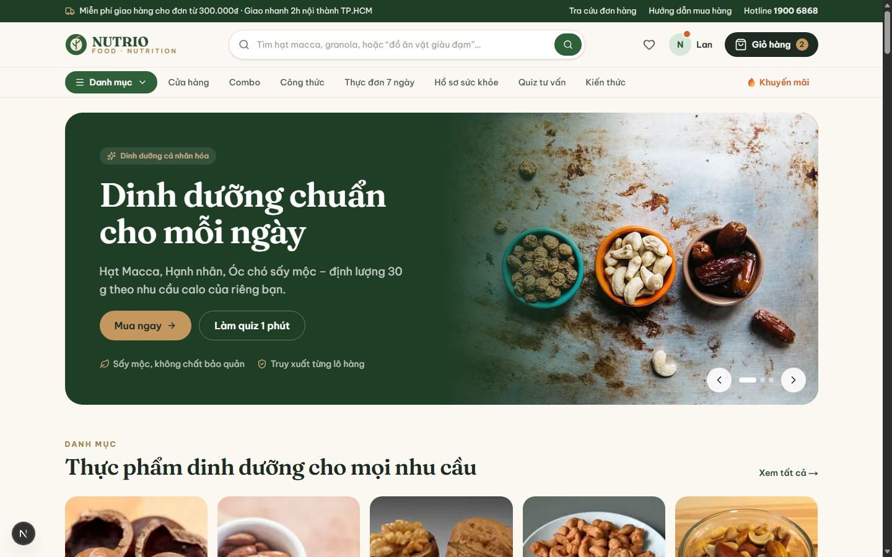
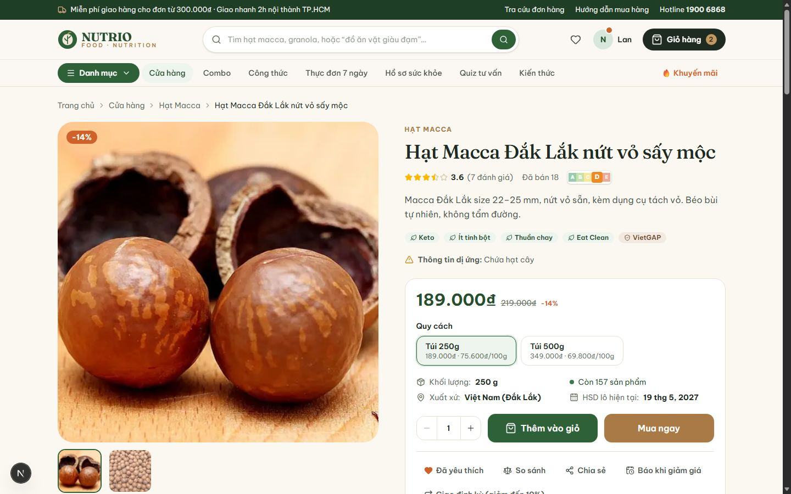
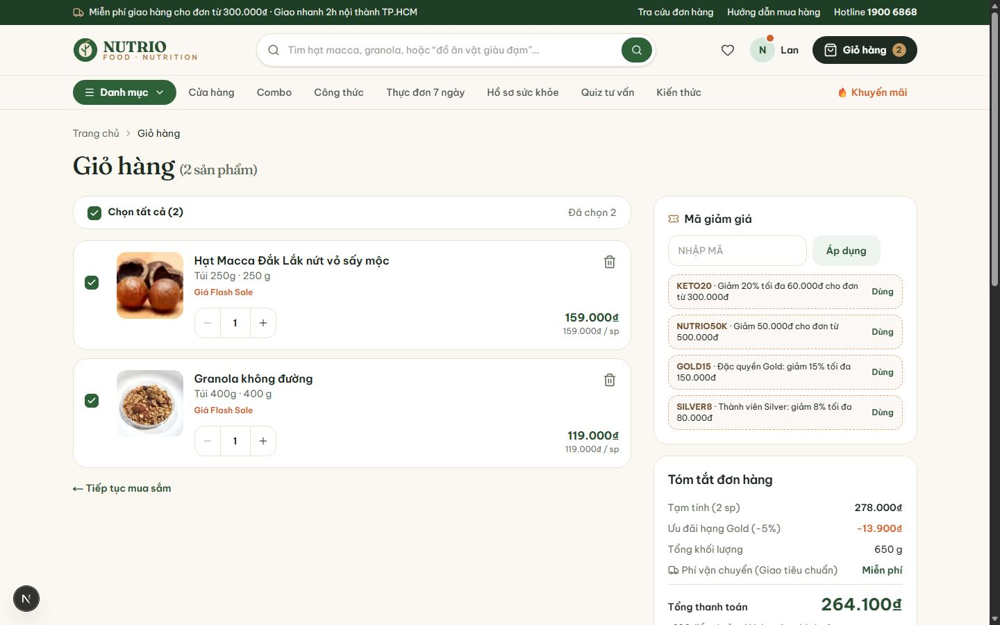
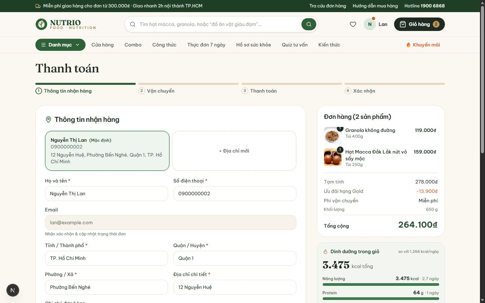
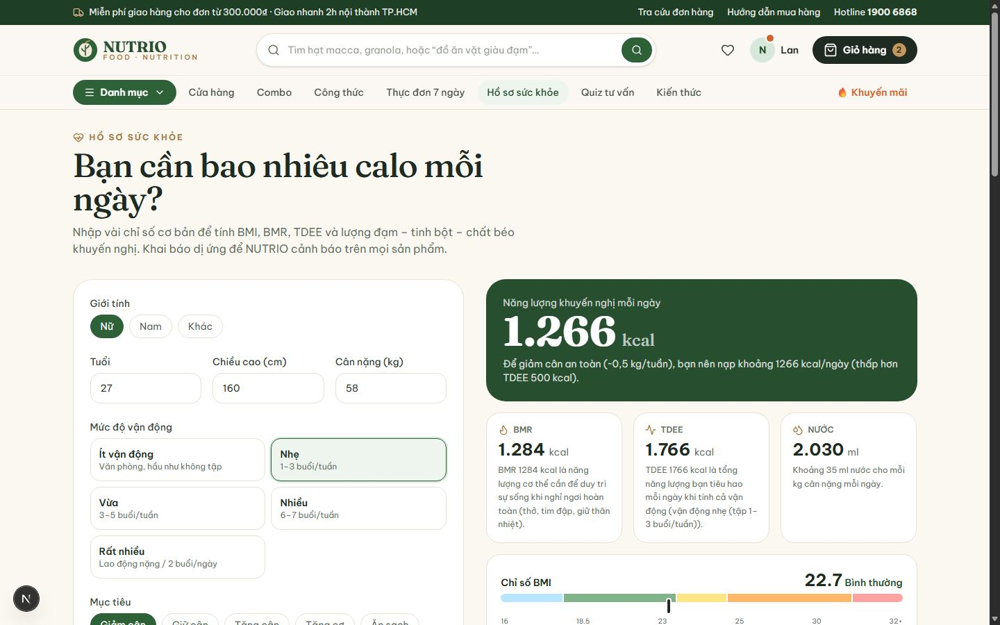
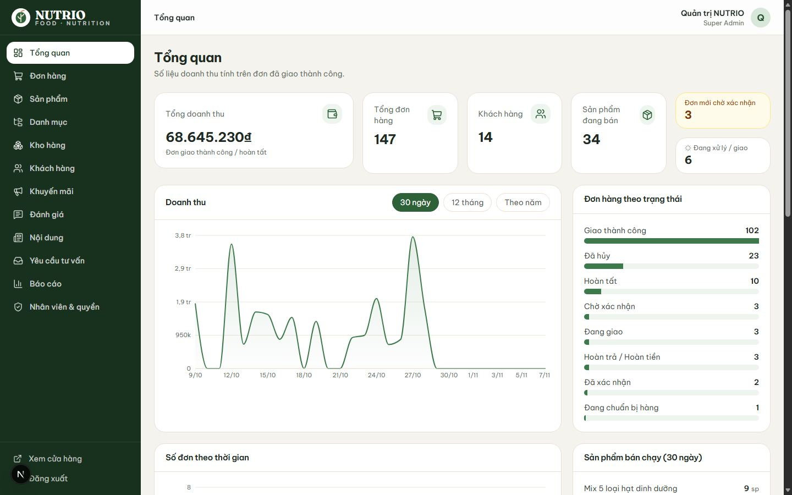
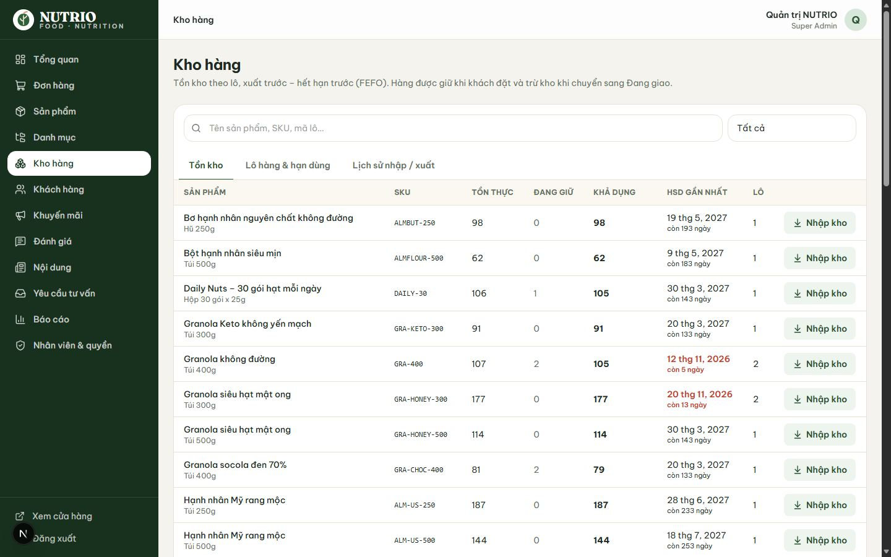
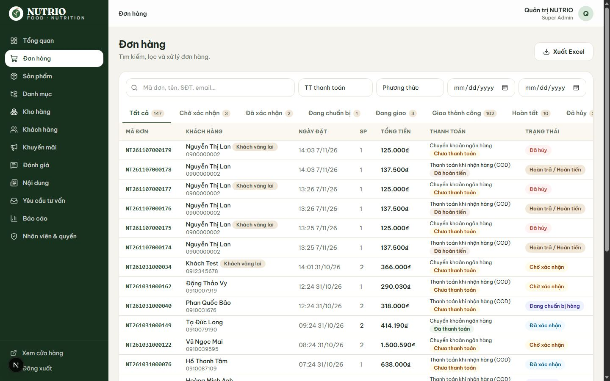
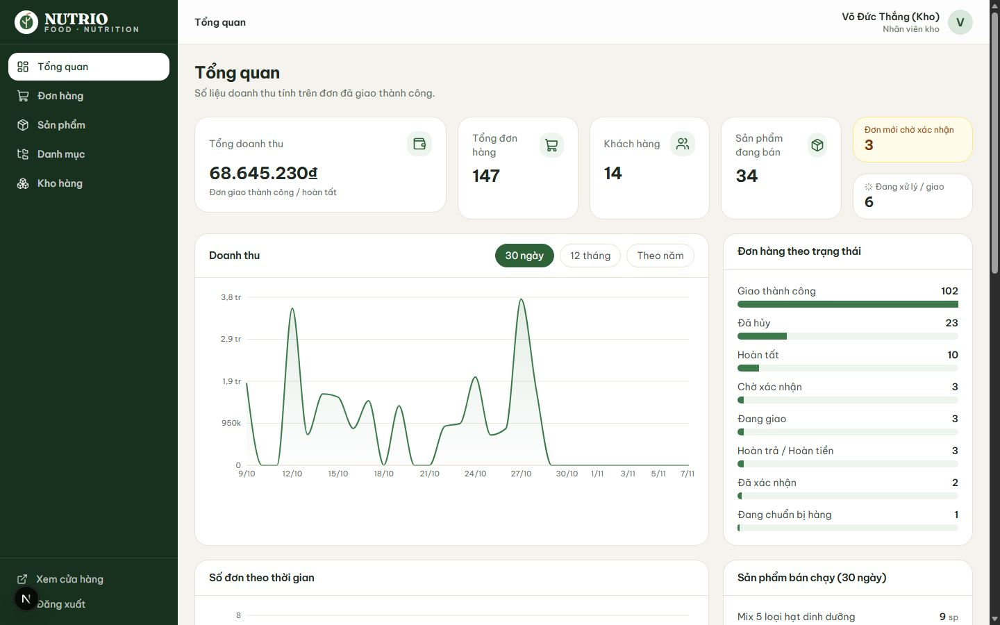

# NUTRIO Food

**Website thương mại điện tử hạt dinh dưỡng & granola, cá nhân hóa theo nhu cầu calo.**

Gồm cửa hàng cho khách, trang quản trị phân quyền chi tiết, quản lý kho theo lô hạn dùng (FEFO) và bộ công cụ dinh dưỡng (BMI/BMR/TDEE, quiz, lọc dị ứng, thực đơn 7 ngày, Nutri-Score).

    



---

## Mục lục
1. [Giới thiệu](#giới-thiệu)
2. [Tính năng](#tính-năng)
3. [Công nghệ](#công-nghệ)
4. [Kiến trúc](#kiến-trúc)
5. [Ảnh chụp màn hình](#ảnh-chụp-màn-hình)
6. [Cài đặt nhanh](#cài-đặt-nhanh)
7. [Tài khoản demo](#tài-khoản-demo)
8. [Cấu trúc thư mục](#cấu-trúc-thư-mục)
9. [API](#api)
10. [Kiểm thử](#kiểm-thử)
11. [Tài liệu](#tài-liệu)
12. [Giới hạn hiện tại](#giới-hạn-hiện-tại)
13. [Bảo mật & dữ liệu](#bảo-mật--dữ-liệu)

---

## Giới thiệu

Khách mua thực phẩm dinh dưỡng thường cần biết **ăn bao nhiêu** và **món nào hợp mục tiêu, không gây dị ứng**. Cửa hàng thực phẩm lại phải quản lý **hạn dùng theo từng lô**. NUTRIO Food giải quyết cả hai:

- Khách tính nhu cầu năng lượng, nhận gợi ý sản phẩm và thực đơn, lọc chất gây dị ứng trên toàn site.
- Hệ thống giữ hàng theo lô hết hạn sớm nhất ngay khi đặt, tính giá hoàn toàn ở server, và xử lý mỗi đơn trong một transaction.

Có 6 nhóm người dùng: khách vãng lai, khách hàng, nhân viên bán hàng, nhân viên kho, nhân viên CSKH, Super Admin. Chi tiết: [docs/PROJECT_OVERVIEW.md](docs/PROJECT_OVERVIEW.md).

## Tính năng

### Cửa hàng
- Trang chủ: banner, danh mục, flash sale đếm ngược, nổi bật/bán chạy/mới, combo, công thức, đánh giá, blog.
- Tìm kiếm **không dấu** kèm gợi ý. Lọc theo giá, chế độ ăn, Nutri-Score, đánh giá, dị ứng, còn hàng, giảm giá.
- Chi tiết sản phẩm: quy cách, tồn kho, HSD lô gần nhất, bảng dinh dưỡng, cảnh báo dị ứng, gợi ý thay thế lành mạnh hơn.
- Yêu thích + báo giảm giá, so sánh 2–3 sản phẩm.
- **Giỏ hàng lưu ở server** cho cả khách vãng lai và thành viên (gộp khi đăng nhập). Có chọn dòng thanh toán, mã giảm giá, phí ship theo ngưỡng, tổng dinh dưỡng của giỏ.
- Checkout 4 bước. COD, chuyển khoản **VietQR**. VNPay/MoMo bật khi có khóa sandbox.
- Tài khoản: đơn hàng (theo dõi, hủy, mua lại), sổ địa chỉ, điểm thưởng & hạng Bronze/Silver/Gold, voucher, đánh giá đã mua (kèm ảnh), thông báo, giao hàng định kỳ.
- Tra cứu đơn cho khách vãng lai (mã đơn + SĐT).

### Dinh dưỡng
- Hồ sơ sức khỏe: BMI (ngưỡng châu Á), BMR (Mifflin–St Jeor), TDEE, calo mục tiêu, macro, nước.
- Quiz 5 câu → gợi ý sản phẩm. Thực đơn 7 ngày: đổi món, lưu, thêm nguyên liệu vào giỏ.
- Nutri-Score A–E tự tính bằng trigger CSDL.

### Quản trị
- Dashboard: doanh thu, đơn, biểu đồ 30 ngày/12 tháng/năm, bán chạy, sắp hết hàng, lô sắp hết hạn.
- Sản phẩm, danh mục; đơn hàng (lọc, chuyển trạng thái theo quy tắc, xác nhận thanh toán, hoàn trả, in hóa đơn, xuất Excel).
- **Kho theo lô**: nhập kho tạo lô + QR truy xuất, xuất hủy, kiểm kê, lịch sử.
- Khách hàng (khóa/mở), khuyến mãi (mã, flash sale, combo), nội dung, duyệt đánh giá, yêu cầu tư vấn.
- Báo cáo + Excel. **Nhân viên & ma trận phân quyền** (15 quyền).

## Công nghệ

| Lớp | Công nghệ |
|---|---|
| Frontend | Next.js 16.3 (App Router, Turbopack), React 19, Tailwind CSS v4, TanStack Query, Zustand, React Hook Form + Zod, Recharts, lucide-react |
| Backend | NestJS 11, Prisma 6.19, Passport JWT, bcryptjs, class-validator, Helmet, Throttler, @nestjs/schedule, Swagger, ExcelJS, Nodemailer, Multer |
| CSDL | PostgreSQL 18.6 chạy nhúng (`embedded-postgres`, cổng 5433). Extension `citext`, `unaccent`, `pg_trgm`, `pgcrypto` |
| Kiểm thử | Bộ E2E API (`backend/test/e2e-api.mjs`), TypeScript, ESLint, oxlint, kiểm thử giao diện bằng puppeteer-core |

## Kiến trúc

```
Trình duyệt ─▶ Next.js :3000 ─REST/JSON─▶ NestJS :5001/api/v1 ─Prisma─▶ PostgreSQL :5433
                                          │ Helmet · CORS · ValidationPipe
                                          │ ThrottlerGuard → JwtAuthGuard → RolesGuard
                                          │ PricingService (báo giá dùng chung)
                                          │ OrderLifecycleService (vòng đời đơn, kho, tiền, điểm)
```

- **Giá luôn tính ở server**: giỏ, checkout và tạo đơn dùng chung một hàm báo giá.
- **Tạo đơn trong một transaction**:
  - Khóa mã giảm giá và giữ hàng theo lô HSD sớm nhất (FEFO).
  - Ghi lượt dùng mã, trừ điểm, tạo bản ghi thanh toán.
  - Khóa `idempotencyKey` chống tạo đơn trùng.
- **Vòng đời 8 trạng thái** với bảng chuyển hợp lệ: Đang giao trừ kho, Giao thành công tính COD đã trả và cộng điểm, Hủy nhả hàng và hoàn điểm/mã, Hoàn trả nhập lại kho và hoàn tiền.
- **CSDL tự bảo vệ**: CHECK tổng tiền đơn, CHECK tồn không âm, 159 khóa ngoại, 40 trigger.

Chi tiết: [SYSTEM_ARCHITECTURE.md](docs/SYSTEM_ARCHITECTURE.md) · [sơ đồ](docs/diagrams/).

## Ảnh chụp màn hình

Chụp từ ứng dụng chạy thật với dữ liệu demo ngày 07/11/2026. Toàn bộ ảnh nằm trong [docs/screenshots/](docs/screenshots/).

| Chi tiết sản phẩm | Giỏ hàng |
|---|---|
|  |  |
| **Checkout** | **Hồ sơ sức khỏe** |
|  |  |
| **Quản trị – Tổng quan** | **Quản trị – Kho theo lô** |
|  |  |
| **Quản trị – Đơn hàng** | **Nhân viên kho chỉ thấy 5 mục menu** |
|  |  |

## Cài đặt nhanh

Yêu cầu: **Node.js ≥ 20.9**. **Không cần cài PostgreSQL**: dự án tự chạy PostgreSQL riêng ở cổng 5433, dữ liệu trong `backend/.pgdata`. Cụm này không ảnh hưởng PostgreSQL khác trên máy, ví dụ của Odoo ở cổng 5432.

```bash
# Backend
cd backend
npm install
npm run setup          # tạo .env từ .env.example (không ghi đè), tạo CSDL, chạy SQL, sinh Prisma client, nạp dữ liệu demo
npm run db:start       # Terminal 1 – PostgreSQL (giữ cửa sổ mở)
npm run start:dev      # Terminal 2 – API http://localhost:5001/api/v1 · Swagger /api/docs

# Frontend
cd ../frontend
npm install
cp .env.example .env.local
npm run dev            # Terminal 3 – http://localhost:3000
```

Sau khi `setup` tạo `backend/.env`, hãy đổi `JWT_SECRET` thành chuỗi ngẫu nhiên.

Hướng dẫn đầy đủ (biến môi trường, sao lưu/khôi phục, xử lý sự cố): [docs/INSTALLATION_GUIDE.md](docs/INSTALLATION_GUIDE.md).

| Lệnh (`backend`) | Tác dụng |
|---|---|
| `npm run db:stop` | Dừng PostgreSQL an toàn (`pg_ctl stop`) – dùng trước khi sao lưu |
| `npm run db:backup` / `db:restore -- <tên>` | Sao lưu / khôi phục CSDL (chạy `db:stop` trước) |
| `npm run db:refresh-demo -- --apply` | Mở lại flash sale demo đã hết hạn |
| `npm run db:cleanup-test` | Liệt kê dữ liệu do kiểm thử sinh ra (`-- --apply` để dọn) |
| `npm run test:e2e` | Chạy bộ kiểm thử API (cần CSDL + API đang chạy) |

## Tài khoản demo

> Tài khoản **chỉ dùng cho môi trường demo cục bộ** do `npm run db:seed` tạo. Đây không phải thông tin production; hãy đổi hoặc xóa khi triển khai thật.

| Vai trò | Email | Mật khẩu | Quyền chính |
|---|---|---|---|
| Super Admin | `admin@nutrio.vn` | `Admin@123` | Toàn quyền (15/15) |
| Nhân viên bán hàng | `sales@nutrio.vn` | `Staff@123` | Đơn hàng, xác nhận thanh toán, khách hàng (xem), khuyến mãi, báo cáo |
| Nhân viên kho | `kho@nutrio.vn` | `Staff@123` | Kho theo lô, cập nhật trạng thái đơn |
| Nhân viên CSKH | `cskh@nutrio.vn` | `Staff@123` | Xem đơn & khách hàng, duyệt đánh giá |
| Khách hàng (Gold, có lịch sử đơn) | `lan@example.com` | `User@123` | Mua hàng, tài khoản |
| Khách hàng | `minh@example.com` | `User@123` | Mua hàng, tài khoản |

Cả 6 tài khoản đã được kiểm tra đăng nhập và phân quyền bằng API ngày 07/11/2026 ([ROLE_PERMISSION.md §4](docs/ROLE_PERMISSION.md#4-kết-quả-kiểm-tra-thực-tế)).

Mã giảm giá mẫu: `GIAM30K` (đơn từ 200K), `FREESHIP` (từ 300K), `WELCOME10` (đơn đầu), `NUTRIO50K`, `KETO20`, `SILVER8`/`GOLD15` (theo hạng), `HETHAN10` (đã hết hạn, để minh họa).

## Cấu trúc thư mục

```
├── backend/
│   ├── scripts/              db.mjs (start/setup/migrate/backup/restore/reset), cleanup-test-data.mjs, refresh-demo-dates.mjs
│   ├── prisma/schema.prisma  Introspect từ CSDL
│   ├── src/
│   │   ├── common/           Guard, decorator, filter, permissions.ts
│   │   ├── core/             Email, thông báo, upload
│   │   ├── modules/          auth users products categories carts pricing orders payments reviews
│   │   │                     nutrition quiz recipes content subscriptions admin
│   │   └── seed/             Dữ liệu demo
│   └── test/e2e-api.mjs      Bộ kiểm thử API 41 kịch bản
├── database/init/            01_schema · 02_seed · 03..05 migration
├── frontend/src/
│   ├── app/(shop)/           Trang cửa hàng & tài khoản
│   ├── app/(admin)/admin/    Trang quản trị
│   └── components/ hooks/ stores/ lib/ types/
├── frontend/public/images/   Ảnh sản phẩm, công thức, banner – nguồn: IMAGE_CREDITS.md
├── docs/                     Tài liệu, sơ đồ, ảnh chụp, tài liệu bảo vệ
└── FINAL_HANDOVER_REPORT.md
```

## API

- Base URL `http://localhost:5001/api/v1`, Swagger tại `/api/docs`.
- 165 endpoint: 62 công khai, 36 cần đăng nhập, 67 cần quyền quản trị.
- Danh sách đầy đủ sinh từ mã nguồn: [docs/API_DOCUMENTATION.md](docs/API_DOCUMENTATION.md).

## Kiểm thử

| Hạng mục | Kết quả (07/11/2026) |
|---|---|
| E2E API (`npm run test:e2e`) | **41/41 đạt**: phân quyền 4 vai trò, tạo sản phẩm, nhập kho, giỏ vượt tồn, đặt hàng dùng điểm, chống đơn trùng, giữ/trừ/nhả/nhập lại kho, chuyển trạng thái sai bị chặn, COD, xác nhận chuyển khoản, hoàn tiền, đánh giá chỉ người đã mua, khách vãng lai + tra cứu, BMR/TDEE, thực đơn, quiz, lọc dị ứng, xuất Excel |
| TypeScript (2 dự án), oxlint, `nest build` | Đạt |
| ESLint frontend | 0 lỗi, 2 cảnh báo (React Hook Form × React Compiler) |
| `next build` | Đạt, 48 route |
| Giao diện (25 trang, 4 tài khoản) | 0 lỗi console |
| Unit test | Chưa có |

Báo cáo chi tiết: [docs/TESTING_REPORT.md](docs/TESTING_REPORT.md).

## Tài liệu

| Tài liệu | Nội dung |
|---|---|
| [PROJECT_OVERVIEW](docs/PROJECT_OVERVIEW.md) | Mục tiêu, đối tượng, phạm vi, số liệu |
| [SYSTEM_ARCHITECTURE](docs/SYSTEM_ARCHITECTURE.md) | Kiến trúc, module, pipeline request |
| [DATABASE_DESIGN](docs/DATABASE_DESIGN.md) | Bảng, ràng buộc, trigger, dữ liệu demo, dọn dữ liệu kiểm thử, sao lưu/khôi phục, tách biệt với Odoo |
| [BUSINESS_FLOWS](docs/BUSINESS_FLOWS.md) | Báo giá, đặt hàng, thanh toán, vòng đời đơn, kho FEFO, dinh dưỡng |
| [ROLE_PERMISSION](docs/ROLE_PERMISSION.md) | RBAC, ma trận quyền, kết quả kiểm tra |
| [API_DOCUMENTATION](docs/API_DOCUMENTATION.md) | 165 endpoint |
| [TESTING_REPORT](docs/TESTING_REPORT.md) | Kết quả kiểm thử, lỗi đã sửa, phần chưa kiểm thử |
| [INSTALLATION_GUIDE](docs/INSTALLATION_GUIDE.md) | Cài đặt, biến môi trường, lệnh CSDL |
| [USER_MANUAL](docs/USER_MANUAL.md) | Hướng dẫn khách hàng và quản trị |
| [diagrams/](docs/diagrams/) | Use case, activity, sequence, ERD, component, deployment (Mermaid) |
| [defense/](docs/defense/) | Dàn ý thuyết trình, kịch bản demo, 45 câu hỏi bảo vệ, giải thích kỹ thuật |
| [FINAL_HANDOVER_REPORT](FINAL_HANDOVER_REPORT.md) | Trạng thái bàn giao, checklist trước khi nộp |

## Giới hạn hiện tại
- **VNPay/MoMo** có mã tạo URL và xác minh chữ ký, nhưng **chưa thử với cổng sandbox thật** (chưa có khóa).
- **Email** cần cấu hình SMTP; nếu không, email chỉ được ghi log.
- **Vận chuyển** mô phỏng nội bộ (mã vận đơn, hành trình), chưa kết nối GHN/GHTK.
- Ảnh upload lưu trên đĩa máy chủ. Quận/Huyện, Phường/Xã nhập tay.
- Chưa có unit test, CI. `docker-compose.yml` chưa được kiểm thử.
- Dữ liệu dinh dưỡng, chứng nhận trong dữ liệu demo mang tính minh họa.

## Bảo mật & dữ liệu
- `backend/.env`, `frontend/.env.local`, `backend/.pgdata`, `backend/uploads`, `backend/backups` đều đã được gitignore. **Không commit file `.env`.**
- Khóa bí mật (JWT, SMTP, VNPay, MoMo) chỉ đặt trong `.env`. `.env.example` chỉ chứa giá trị mẫu.
- Dữ liệu người dùng demo là dữ liệu giả. Ảnh sản phẩm lấy từ Wikimedia Commons ([IMAGE_CREDITS.md](frontend/public/images/IMAGE_CREDITS.md)).

---
Nhóm 04 – HUFLIT
