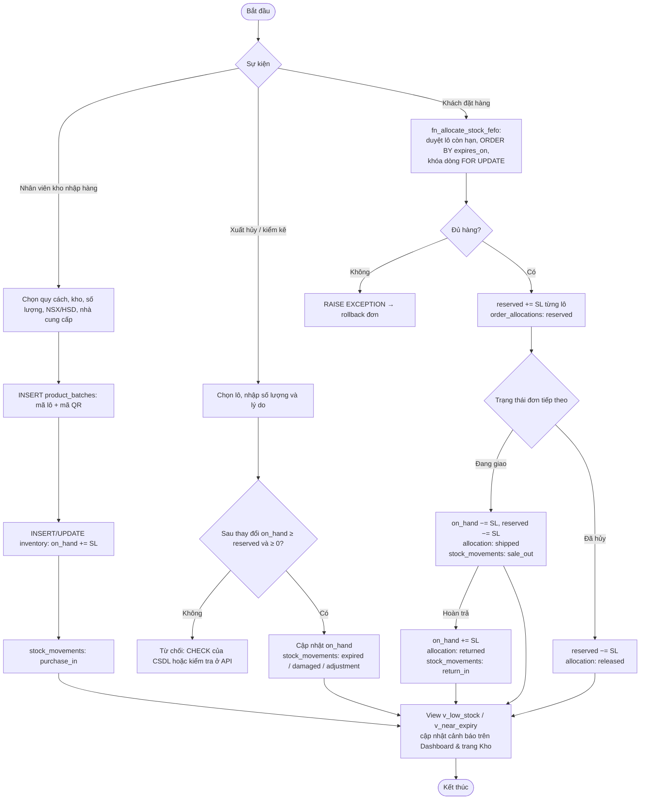

# Sơ đồ hoạt động – Quản lý tồn kho (theo lô, FEFO)

Căn cứ: `admin-inventory.controller.ts` (receive / issue / adjust), `fn_allocate_stock_fefo` (`01_schema.sql`), `order-lifecycle.service.ts`.

**Tồn khả dụng** = Σ (`quantity_on_hand − quantity_reserved`) của các lô còn hạn ở kho đang hoạt động. Đây là con số giỏ hàng dùng để kiểm tra.
