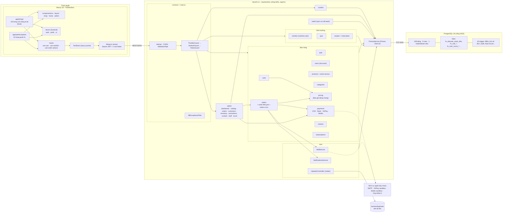

# Sơ đồ thành phần (Component)

Căn cứ: `backend/src/app.module.ts` (danh sách module, guard toàn cục), `backend/src/modules/*`, `frontend/src/*`.

| Thành phần | Trách nhiệm chính |
|---|---|
| `PricingService` | Nơi duy nhất tính giá, giảm giá, phí ship và điểm |
| `OrdersService.placeOrder` | Tạo đơn nguyên tử, giữ hàng FEFO |
| `OrderLifecycleService` | Nơi duy nhất đổi trạng thái đơn và xử lý tác động phụ |
| `RolesGuard` + `permissions.ts` | RBAC theo quyền |
| `OrdersCron` | Hủy đơn online quá hạn thanh toán |
| `admin/excel.ts` | Xuất Excel bằng ExcelJS |
