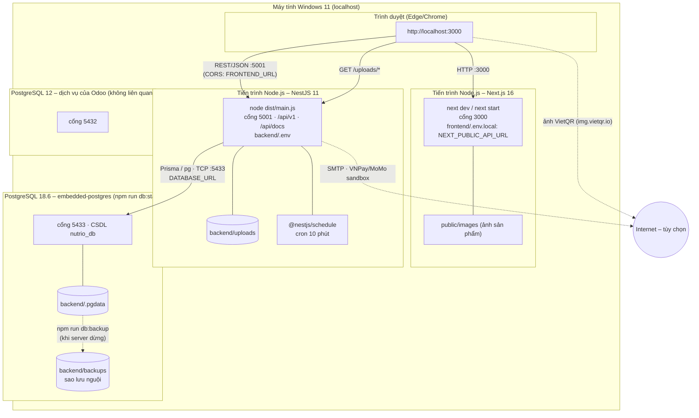
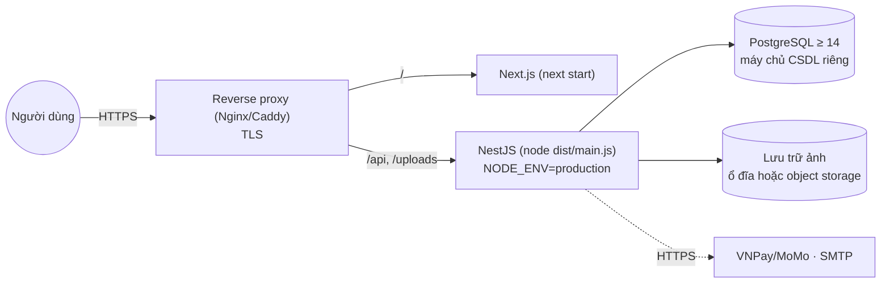

# Sơ đồ triển khai (Deployment)

## 1. Môi trường đã chạy và kiểm thử: máy phát triển Windows 11

Căn cứ: `backend/scripts/db.mjs`, `backend/.env.example`, `frontend/.env.example`, `backend/src/main.ts`.

- **3 tiến trình** chạy song song trong 3 terminal: `npm run db:start`, `npm run start:dev` (hoặc `start:prod`), `npm run dev`.
- NUTRIO **không kết nối** tới PostgreSQL của Odoo. Hai cụm khác phiên bản, khác cổng và khác thư mục dữ liệu.

## 2. Triển khai đề xuất (chưa thực hiện)

Phương án tham khảo nếu đưa lên máy chủ. Phương án này **chưa được triển khai hay kiểm thử** trong dự án.

Việc cần làm khi triển khai thật:

- Đặt `JWT_SECRET` mạnh.
- Đặt `FRONTEND_URL`/`PUBLIC_API_URL` theo tên miền.
- Dùng PostgreSQL có `pg_dump` để sao lưu định kỳ.
- Cấu hình SMTP và khóa cổng thanh toán.
- Bật HTTPS.
