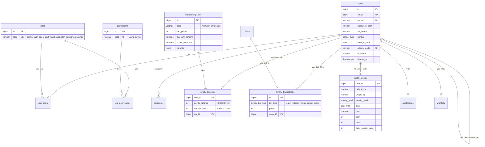
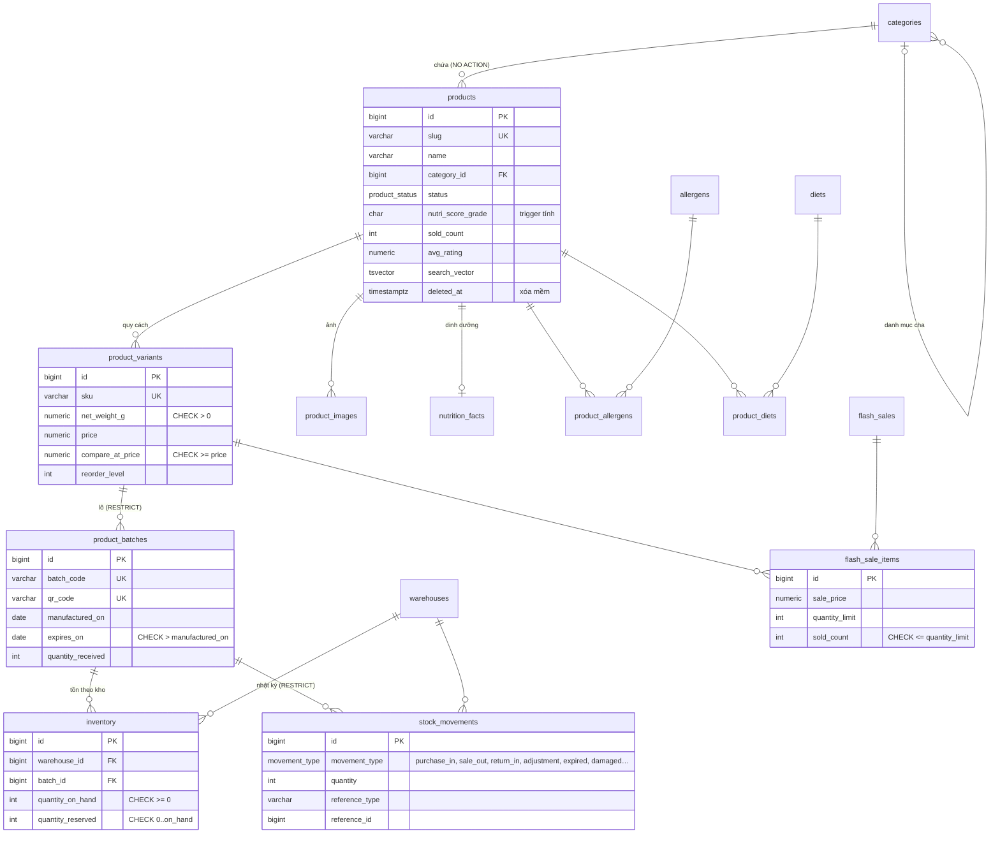
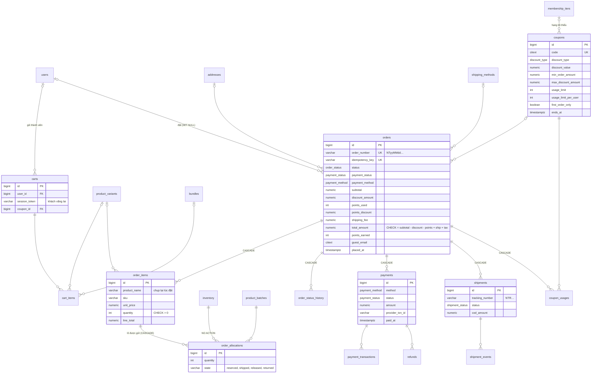
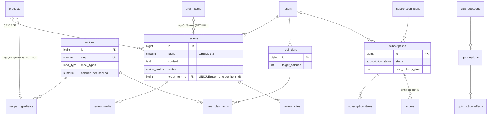

# ERD – Sơ đồ thực thể liên kết

CSDL có 108 bảng. Để dễ đọc, ERD được chia thành 4 sơ đồ theo miền nghiệp vụ. Các quan hệ lấy đúng từ khóa ngoại trong `pg_constraint`. Mỗi bảng chỉ ghi các cột chính; danh sách cột đầy đủ xem `database/init/01_schema.sql` hoặc `backend/prisma/schema.prisma`.

Hành vi khi xóa bản ghi cha: CASCADE (xóa theo), SET NULL (đặt null), NO ACTION/RESTRICT (chặn xóa). Chi tiết ở [DATABASE_DESIGN.md §4](../DATABASE_DESIGN.md#4-ràng-buộc-toàn-vẹn-tiêu-biểu).

## 1. Người dùng, phân quyền, thành viên

## 2. Sản phẩm và kho

## 3. Giỏ hàng, đơn hàng, thanh toán, vận chuyển

## 4. Đánh giá, dinh dưỡng, nội dung

