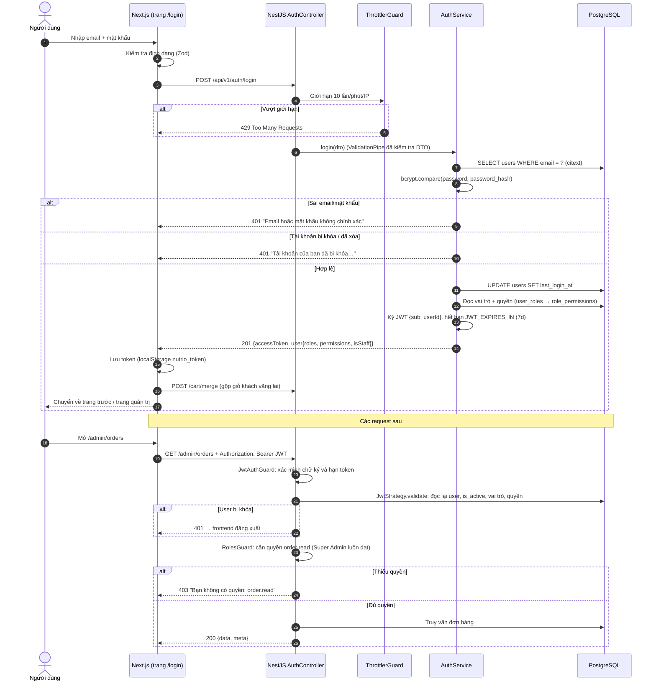

# Sơ đồ tuần tự – Đăng nhập và gọi API có bảo vệ

Căn cứ: `frontend/src/stores/auth.ts`, `lib/api.ts`; `backend/src/modules/auth/auth.service.ts`, `strategies/jwt.strategy.ts`, `common/guards/*.ts`.

