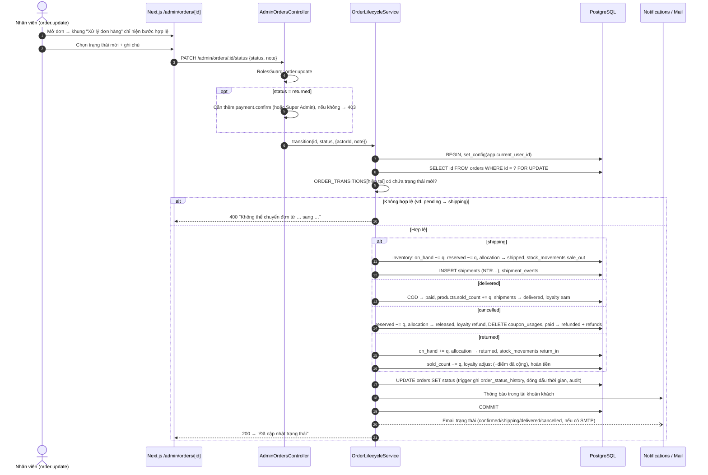
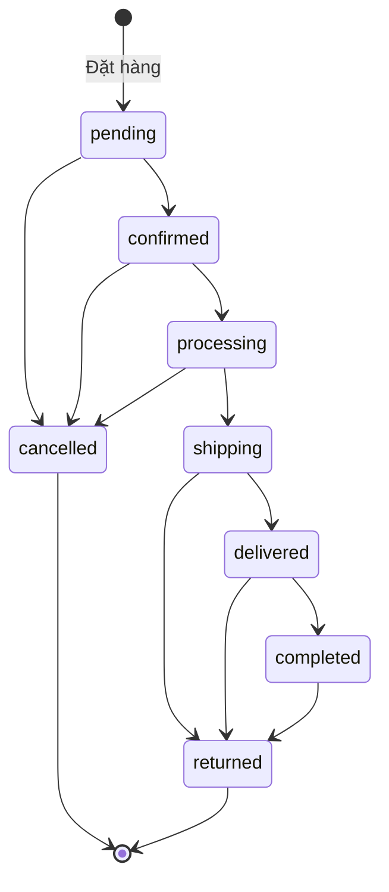

# Sơ đồ tuần tự – Quản lý đơn hàng (chuyển trạng thái)

Căn cứ: `admin-orders.controller.ts` (`updateStatus`), `order-lifecycle.service.ts` (`transition`), `order-status.ts` (`ORDER_TRANSITIONS`), trigger `trg_order_status_history`, `trg_order_status_stamp`.

## Bảng chuyển trạng thái (`ORDER_TRANSITIONS`)

- Khách tự hủy được khi đơn ở `pending` hoặc `confirmed`.
- Đơn VNPay/MoMo quá 60 phút chưa thanh toán sẽ bị cron hủy.
