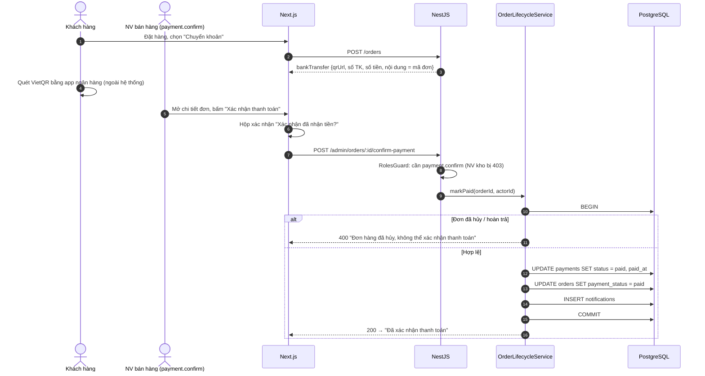
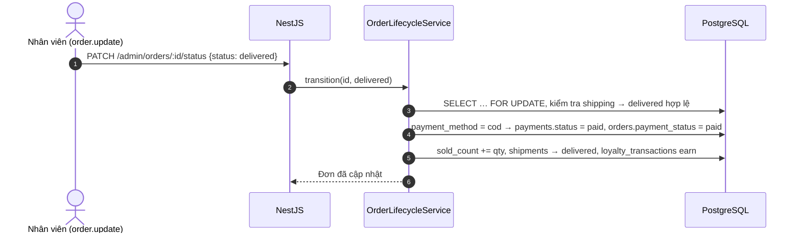
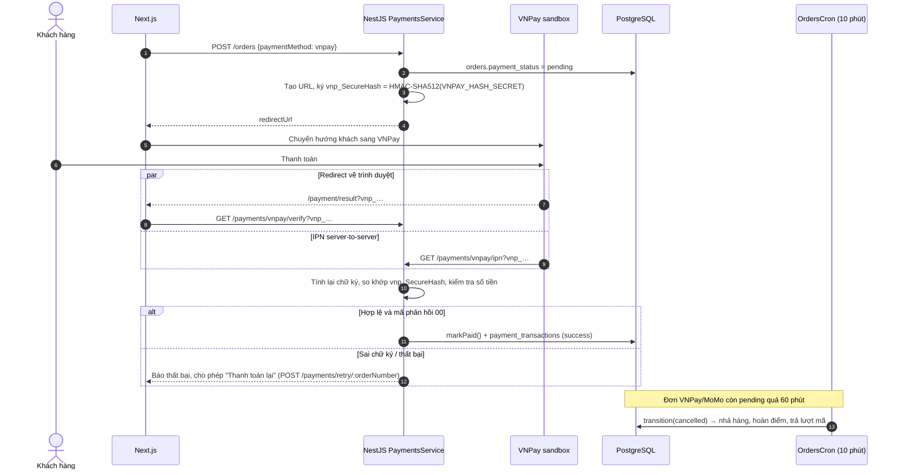

# Sơ đồ tuần tự – Thanh toán

Căn cứ: `payments.service.ts`, `payments.controller.ts`, `admin-orders.controller.ts` (`confirmPayment`), `order-lifecycle.service.ts` (`markPaid`, `transition`), `orders.cron.ts`.

> VNPay/MoMo chỉ hoạt động khi `.env` có khóa sandbox. Trong dự án hiện tại hai cổng này **chưa được kiểm thử với cổng thật**. Luồng chuyển khoản và COD đã có trong bộ E2E.

## 1. Chuyển khoản (VietQR) – nhân viên xác nhận

## 2. COD

## 3. VNPay (MoMo tương tự, ký HMAC-SHA256)

