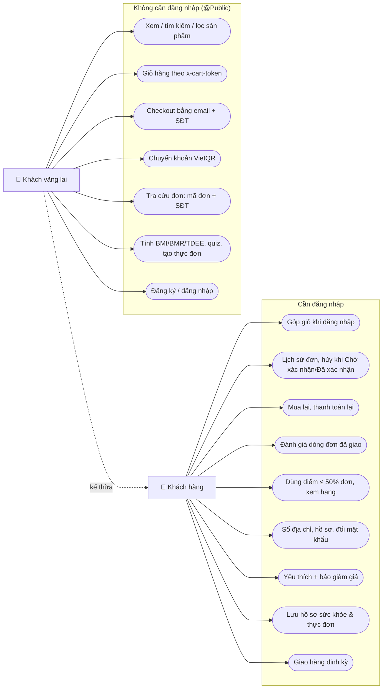
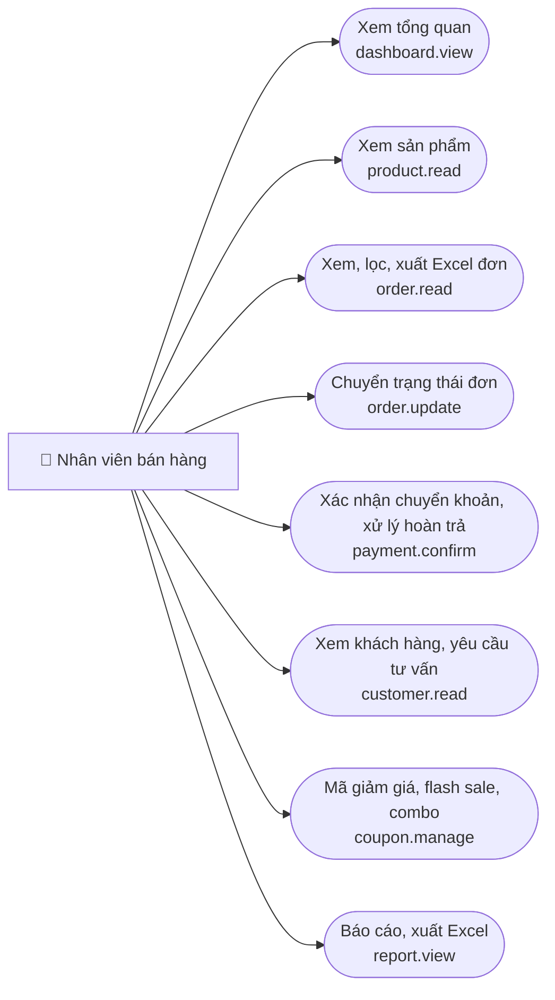
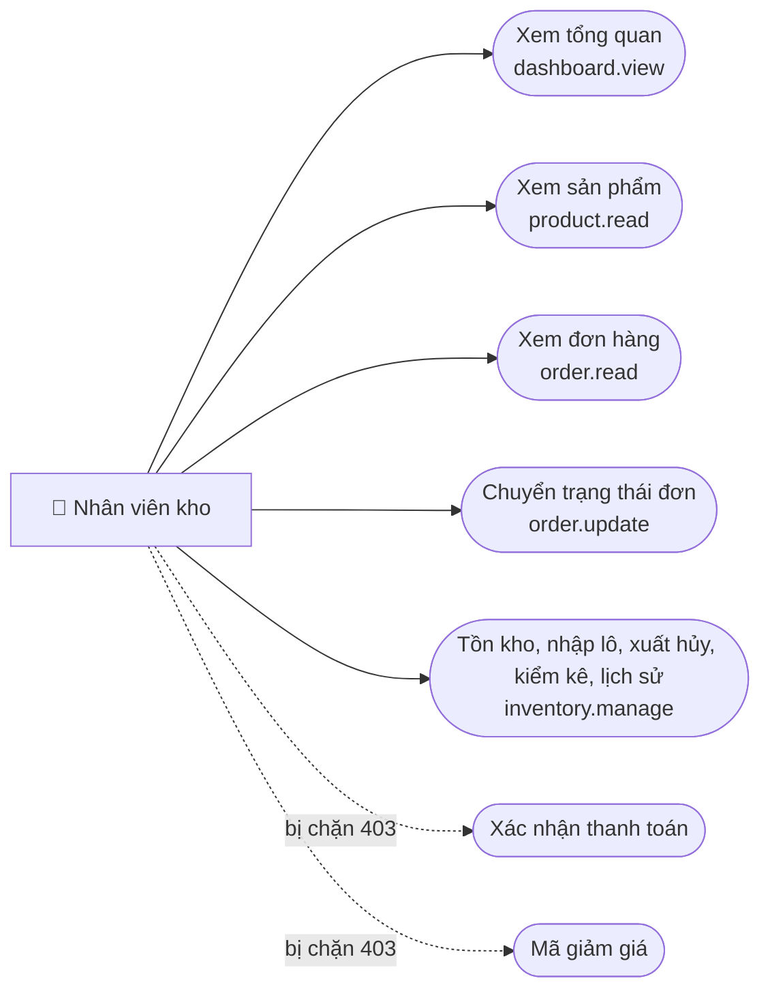
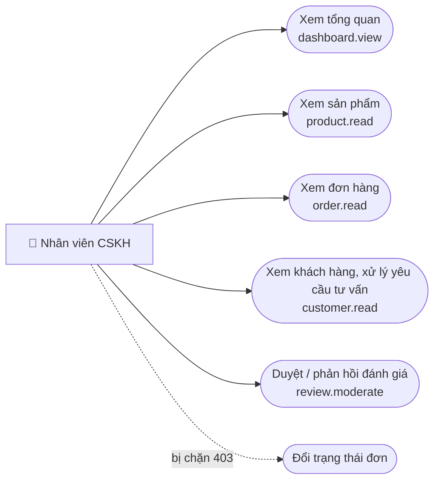
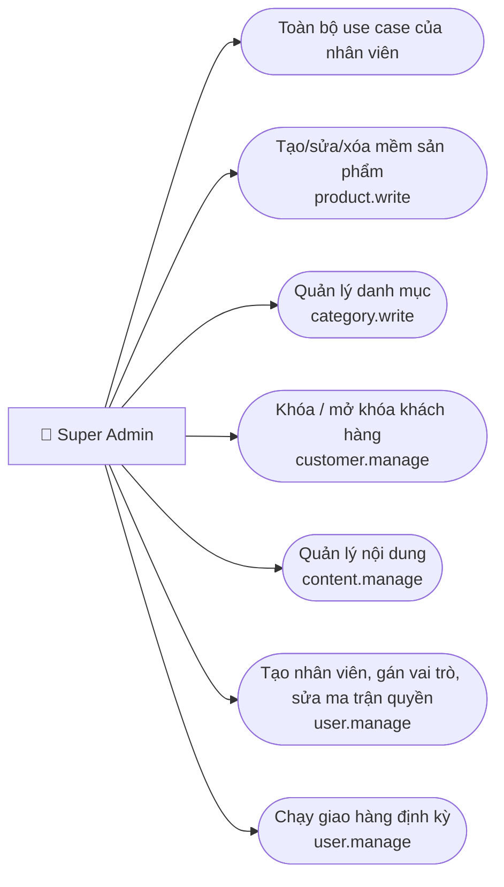

# Use case theo vai trò

Căn cứ: bảng `role_permissions` trong CSDL (đã kiểm tra qua `GET /auth/me`) và `@RequirePermissions` trên từng endpoint.

## 1. Khách vãng lai và khách hàng thành viên

## 2. Nhân viên bán hàng (`staff_sales`, 8 quyền)

## 3. Nhân viên kho (`staff_warehouse`, 5 quyền)

## 4. Nhân viên CSKH (`staff_support`, 5 quyền)

## 5. Super Admin (`admin`, toàn quyền)

