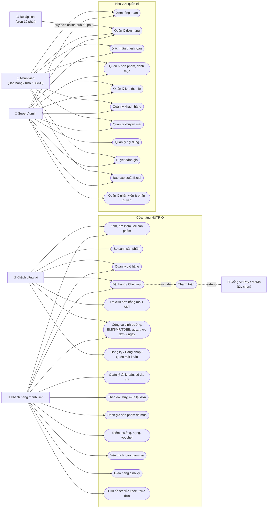

# Use case tổng quan

Mermaid không có ký hiệu use case UML chuẩn. Sơ đồ dùng `flowchart`: tác nhân là hình chữ nhật, use case là hình bo tròn, mũi tên nét đứt là quan hệ «include»/«extend».

Nhân viên chỉ thực hiện được những use case thuộc quyền của vai trò mình. Chi tiết ở [usecase-by-role.md](usecase-by-role.md).
